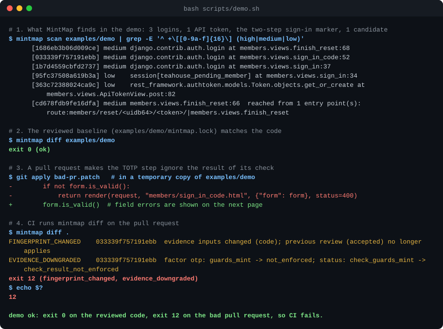
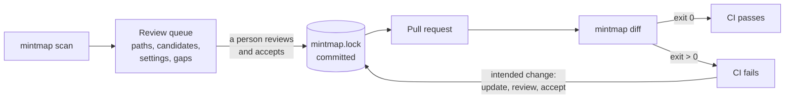

# MintMap

**A reviewed map of the code paths that create a login session or credential in a Django app, enforced in CI.**

[](https://github.com/mohamedmoatazsec/mintmap/actions/workflows/tests.yml)
[](LICENSE)
[](pyproject.toml)
[](#accuracy)
[](https://github.com/mohamedmoatazsec/mintmap/releases)

> **Status: experimental (0.6.0a1).** MintMap was built on eight open-source Django projects, then frozen and
> tested on three it had never seen (CVAT, Label Studio, Tandoor). There it linked 28 of 66 credential paths to the
> right route, pointed to 30 more only indirectly (an unlinked mint, a candidate or a named gap) and missed 8 (12%)
> with no warning. 43% of the paths it reported were false alarms, and `diff` let 23 of 65 harmful test changes
> through. (The previous release, 0.5.0a1, missed 30% with no warning on an earlier, harder set of unseen projects.)
> It is a review aid, not a guarantee. Read [Accuracy](#accuracy) first.

In a Django app the ways to get logged in are scattered: the login view, auto-login after sign-up or password
reset, SSO callbacks, magic links, two-factor steps, API tokens, admin impersonation. Any pull request can add one
or weaken one without the reviewer noticing that it touched authentication; a classic bug is a two-factor check
that still runs but whose result is ignored. MintMap parses the code (it never runs it), looks for the paths that
create a session or credential, stores the ones it finds in a human-reviewed `mintmap.lock`, and fails CI when that
set, or the code and checks on it, change. What makes it different is the combination: a reviewed baseline plus a
CI diff, an explicit list of what it could not analyse, and a published miss rate measured on projects it had
never seen.

<p align="center">
  
</p>

**Contents:** [Try it in 60 seconds](#try-it-in-60-seconds) · [How it works](#how-it-works) ·
[Use it on your project](#use-it-on-your-project) · [GitHub Action](#github-action) · [Exit codes](#exit-codes) ·
[Accuracy](#accuracy) · [Known blind spots](#known-blind-spots) ·
[Semgrep or CodeQL?](#how-is-this-different-from-semgrep-or-codeql) · [FAQ](#faq) ·
[Contributing](#contributing)

## Try it in 60 seconds

You need Python 3.11 or newer and git. Check `python3 --version`: the `python3` of macOS's command-line tools
(3.9) and of Ubuntu 22.04 (3.10) are too old; with a newer one installed, run
`PYTHON=python3.12 bash scripts/demo.sh`. Nothing is installed, and Django is not needed: MintMap only parses code.

```bash
git clone https://github.com/mohamedmoatazsec/mintmap
cd mintmap
bash scripts/demo.sh
```

The script scans the small Django project in [`examples/demo`](examples/demo), applies a bad pull request
([`bad-pr.patch`](examples/demo/bad-pr.patch)) to a temporary copy and shows `mintmap diff` failing. The image
above is its output, and CI re-checks both on every push.

On Windows, run the script in Git Bash or WSL, or follow the steps by hand below in PowerShell. `mintmap diff`
prints its exit code on its last line; in PowerShell use `echo $LASTEXITCODE` where the steps say `echo $?`.

<details>
<summary>The same steps by hand</summary>

```bash
python3 -m venv .venv && . .venv/bin/activate   # Windows: .venv\Scripts\activate
python -m pip install .                 # or skip both lines and use: python3 -I scripts/run_mintmap.py <arguments>

mintmap scan examples/demo              # the review queue, the check evidence and the gaps
mintmap diff examples/demo; echo $?     # 0: the code matches the reviewed lock

git apply --directory=examples/demo examples/demo/bad-pr.patch
mintmap diff examples/demo; echo $?     # 12: fingerprint_changed + evidence_downgraded

git apply -R --directory=examples/demo examples/demo/bad-pr.patch    # undo
```

</details>

## How it works



1. **Finds mint sites**: calls that create a session or credential (`django.contrib.auth.login`, DRF and JWT
   tokens, django-allauth flows, OAuth2 provider tokens, project-made tokens built from `secrets`/`uuid4`, ...).
2. **Traces them to entry points**: URL routes (including `include()`, routers, helper functions, i18n
   patterns), middleware, admin registrations and library views.
3. **Records the checks it can see on the way**: password, TOTP, WebAuthn, token signature, permission gates, and
   a best-effort judgement of whether each check's result decides the outcome. This evidence is often weaker than
   the truth and sometimes wrong (see [Accuracy](#accuracy)).
4. **Writes `mintmap.lock`**, which a security reviewer approves once.
5. **Fails CI** when a pull request adds or removes a path, changes the code or checks on a reviewed path,
   weakens a check, or reduces what MintMap can analyse. Many constructs it cannot analyse are listed as
   **gaps**, but not all: on projects it was not developed against, 0.6.0a1 missed 12% of credential paths with no
   gap at all (0.5.0a1 missed 30% on an earlier, harder project set; see [Accuracy](#accuracy)).

Since 0.6.0a1 MintMap also reports two lower-confidence tiers, both fingerprinted and diffed like paths:

| Tier | What it is | Lock entry |
|---|---|---|
| **Candidates** | Sites with a structural reason to be reviewed: hand-written session state, passwords set from a value the code does not generate, calls into authentication libraries the catalog does not describe, project code that authenticates requests itself, and more | one per kind, `candidates:<kind>` |
| **Watched sites** | Sites a precision rule set aside as *not* being credentials, kept under watch so that a wrong judgement on unfamiliar code still shows up in `diff` | one per rule, `watched:<kind>` |

The full explanation of paths, candidates, watched sites, gaps, settings groups, the review queue and the lock is
in **[docs/CONCEPTS.md](docs/CONCEPTS.md)**.

<details>
<summary>Real output on a real project (Healthchecks)</summary>

After a one-line change that makes the Healthchecks TOTP form accept every code:

```
$ mintmap diff .
FINGERPRINT_CHANGED    e06b237f9895851e  evidence inputs changed (checks); previous review (accepted) no longer applies
EVIDENCE_DOWNGRADED    e06b237f9895851e  factor otp: guards_mint -> present_unproven; status: check_guards_mint -> check_present_relationship_unproven
exit 12 (fingerprint_changed, evidence_downgraded)
```

</details>

## Use it on your project

Install MintMap in a virtualenv or with pipx (the system Python of current Debian, Ubuntu and Homebrew refuses
`pip install` outside one, PEP 668). It needs Python 3.11 or newer and nothing else.

```bash
python3 -m venv .venv && . .venv/bin/activate     # Windows: .venv\Scripts\activate
python -m pip install mintmap                     # or: pipx install mintmap
# or from the release tag: python -m pip install "git+https://github.com/mohamedmoatazsec/mintmap@v0.6.0a2"
```

Then point it at the Django project (the directory that contains `manage.py`) and review what it finds:

```bash
mintmap scan   path/to/django/project            # the review queue, path evidence and the gaps
mintmap init   path/to/django/project            # write mintmap.lock (all entries unreviewed)
# review every group the scan lists, then record the decision: one --group at a time
# (kind:session, kind:token, ..., settings), or all of them at once after the review:
mintmap accept path/to/django/project --all --reviewer "alice" --note "initial review"
mintmap diff   path/to/django/project; echo $?   # must print exit 0; 64 means some entries are still unreviewed
git add path/to/django/project/mintmap.lock && git commit -m "Add reviewed MintMap lock"
```

| Command | What it does |
|---|---|
| `mintmap scan <dir>` | Prints the review queue, the check evidence of each path it reports and the gaps. `--json out.json` writes the full report |
| `mintmap init <dir>` | Writes `mintmap.lock` with every entry unreviewed |
| `mintmap accept <dir> ...` | Records a review: `--group <group>`, `--all`, or entry ids, with `--reviewer <name>` |
| `mintmap diff <dir>` | Compares the code with the lock and exits with a [bitmask](#exit-codes). This is what CI runs |
| `mintmap update <dir>` | After an intended change: refreshes the lock (changed entries become unreviewed again) |
| `mintmap --version` | Prints the version (on `main`; not in the `v0.6.0a1` tag) |

**The review queue.** The text report of `scan` starts with a review queue (since 0.6.0a1): confirmed paths
grouped by credential kind (`kind:session`, `kind:token`, `kind:precursor`, `kind:custom`, `kind:other`) and entry
point, candidate sites by kind, the settings groups and the watched groups. Inside a group the entries are ranked
by a transparent risk score, each with a `why` line. The ranking is a hint, not a verdict: in the evaluation,
false alarms were sometimes ranked high and an administrator setting any user's password was ranked low.
`mintmap accept --group <group>` accepts one such group. Details: [docs/CONCEPTS.md](docs/CONCEPTS.md#the-review-queue).

**After an intended change:** `mintmap update <dir>` refreshes the lock, then
`mintmap accept <dir> <ids...> --reviewer <name>`.

**Optional:** `--library-path <dir>` lets MintMap read library source (still without importing it), which can
resolve library view aliases in some layouts. In our evaluation it changed no result.

## GitHub Action

```yaml
# .github/workflows/mintmap.yml
on: pull_request
permissions:
  contents: read
jobs:
  mintmap:
    runs-on: ubuntu-latest
    steps:
      - uses: actions/checkout@3d3c42e5aac5ba805825da76410c181273ba90b1 # v7.0.1
        with:
          persist-credentials: false
      # Replace the tag with the release's full commit SHA (keep the tag as a comment): a tag can be moved.
      - uses: mohamedmoatazsec/mintmap@v0.6.0a2
        with:
          project-dir: .
```

To pin the full commit SHA of a release tag, look it up with
`git ls-remote https://github.com/mohamedmoatazsec/mintmap refs/tags/v0.6.0a2` and write
`mohamedmoatazsec/mintmap@<sha> # v0.6.0a2`.

The job fails on any finding (configurable with `fail-on`; exit 128, "MintMap could not run", always fails) and
writes a summary table to the job page. The action runs MintMap from its own checkout with `python -I`, so files
added by a pull request cannot replace it; no package is built or installed. It also pauses workflow commands while
MintMap prints text from the pull request. See [`examples/mintmap.yml`](examples/mintmap.yml).

> **The check is only as strong as the review rules around `mintmap.lock`.** Without code-owner review, a pull
> request can accept its own change. Do not run code from the pull request (installing its dependencies, running
> its tests) in the same job before MintMap: anything that runs in the job can replace the check. Follow
> [docs/ENFORCEMENT.md](docs/ENFORCEMENT.md).

## Exit codes

`mintmap diff` exits with a bitmask:

| bit | name | meaning |
|---|---|---|
| 1 | `new_path` | a new way to obtain a session/credential |
| 2 | `removed_path` | a reviewed path disappeared |
| 4 | `fingerprint_changed` | code, checks, hooks or settings on a reviewed path changed |
| 8 | `evidence_downgraded` | a check on a path got weaker |
| 16 | `purpose_changed` | the credential issued on a path changed kind |
| 32 | `coverage_regression` | MintMap can analyse less than before (new gaps, parse failures, changed roots) |
| 64 | `unreviewed` | lock entries not yet accepted |
| 128 | `error` | MintMap could not run (bad arguments, missing or invalid lock, catalog error, or an internal error) |

<details>
<summary>Candidate groups, watched groups and shared mint sites</summary>

A candidate group (`candidates:<kind>`) uses the same bits for its sites (a new site sets 1, a vanished one 2, a
changed one 4, naming new or lost entry points); its findings carry `"tier": "candidate"`. A watched group
(`watched:<kind>`) does the same with `"tier": "watched"`. A mint site shared by many entry points (one lock entry
listing them) sets bit 1 when a new entry point reaches it, and the finding names that entry point.

</details>

**Refactors.** Formatting, comments, docstrings, renamed local variables and several kinds of extracted helper are
normalised and do not change fingerprints. Moving code to another module or class still does (a false alarm).
Even so, 7 of 22 harmless changes raised a finding in the latest evaluation. The exact rules are in
[docs/CONCEPTS.md](docs/CONCEPTS.md#fingerprints).

## Accuracy

MintMap 0.6.0a1 (frozen before the test) was measured on three open-source Django projects that nobody looked at
while it was built: CVAT, Label Studio and Tandoor. The previous release, 0.5.0a1, was run on the same projects as a
control. The reference inventories were written by separate AI agents (not humans) that never saw the tool's
output, and every result was re-checked by an adversarial AI verifier that re-ran both versions:

| | 0.6.0a1 | 0.5.0a1 (control) |
|---|---|---|
| credential paths found and linked to the right route | 28 of 66 (42%) | 26 of 66 (39%) |
| found, but only as an unlinked mint, a candidate or a named gap (1) | 30 of 66 (45%) | 29 of 66 (44%) |
| **missed with no warning** (2) | **8 of 66 (12%)** | **11 of 66 (17%)** |
| reported paths that are not real credential paths | 25 of 58 (43%) | 30 of 61 (49%) |
| lock entries to review on day one / of which false alarms | 88 / 33 | 82 / 33 |
| check evidence on matched paths: agrees / weaker than the truth / wrong (3) | 2 / 38 / 2 of 42 | – |
| harmful code changes caught by `diff` (required categories) | 13 of 18 | 13 of 18 |
| harmful code changes caught (all, incl. project-specific and verifier probes) | 42 of 65 (65%) | 36 of 65 (55%) |
| harmless changes that raised a finding | 7 of 22 | 8 of 22 |

(1) 4 of the 11 "named gap" units are visible only in `--json` output (the text report lists the first 40 gaps).
Label Studio's personal access tokens, its main API credential, are among them and do not appear in the review
queue. (2) By class: full login sessions 0 of 28, tokens 4 of 26, precursors (reset, invitation, MFA state) 4 of
12. Scoring judgement calls move the 0.6.0a1 count between 4 and 12. (3) "Weaker" means the tool claimed less than
was true, typically "no check found" on a login whose password check runs in a serializer or form named by a
library setting. "Wrong" means it claimed something false.

**In short:** 0.6.0a1 is somewhat better than 0.5.0a1 on code neither had seen: 3 fewer silent misses, 6 more
harmful changes caught, fewer false-alarm paths. But most of the large gains it made on its development projects
(silent misses 51 → 4 of 213, harmful changes caught 98 of 98) did not transfer. The project set matters too: on an
earlier set of unseen projects (InvenTree, Weblate, pretix) 0.5.0a1 missed 30% silently, against 17% here. Expect
to miss some tokens and precursors in an unfamiliar codebase, to dismiss many false alarms on day one, and to see
about a third of harmful changes to auth code pass `diff`, mostly where the changed check is reached through
settings-named serializers, library-called hooks or admin code.

Full methodology, per-project numbers and the earlier rounds: [docs/EVALUATION.md](docs/EVALUATION.md).

## Known blind spots

General causes of the misses found in the latest evaluation (0.6.0a1 on CVAT, Label Studio and Tandoor):

- A library's mint function called through the library's settings object (dj-rest-auth
  `api_settings.TOKEN_CREATOR(...)`): neither a path nor a gap.
- Credentials created or edited through the Django admin for project models (`ModelAdmin` saves, admin actions, a
  token field in an admin form). Admin registrations are linked only when the model's `save()` is a known mint.
- A settings module that star-imports its base module through a source-root alias: the base module's
  `INSTALLED_APPS`, `MIDDLEWARE`, `AUTHENTICATION_BACKENDS` and `REST_FRAMEWORK` are not read, and the scan reports
  only the unresolved import (`settings_star_import_unresolved`) and `missing_setting` gaps, not which settings the
  unread base module holds.
- Hooks named in settings and loaded by a project helper (`load_func(settings.X)`), and adapter classes re-exported
  from a package `__init__`: such code is in no fingerprint, so weakening it can pass `diff`.
- DRF routers extended at run time (one global gap), tokens created by `ModelSerializer.create()` through `super()`,
  and credentials written from request data by an update serializer.
- Values whose field name has no credential word (`InviteLink.uuid`) and session writes without a principal-like
  signal are set aside in the JSON report only, not watched.
- Libraries outside the catalog (for example django-auth-ldap) and project code that only such a library calls;
  their settings (for example `AUTH_LDAP_GLOBAL_OPTIONS`) are in no fingerprint, so weakening them passes `diff` (2
  of the 23 harmful test changes that passed in the latest evaluation).
- Not modelled: session lifetime and token revocation checks, project view decorators, admin actions as entry
  points, signed cookies (`set_signed_cookie`) as credentials, multi-request flows. There is no option to choose one
  settings module: MintMap analyses the modules that `DJANGO_SETTINGS_MODULE` literals in the code name and, as
  alternatives, every other leaf settings module except test settings.
- Django only. Library knowledge covers Django auth, DRF, SimpleJWT, knox, djoser, dj-rest-auth, django-allauth,
  social-auth, django-otp, two-factor-auth, sesame, oauth-toolkit and a few more (about 15 packages). Other
  libraries usually show up as gaps, but not always.

<details>
<summary>What 0.6.0a1 added for the blind spots of 0.5.0a1</summary>

0.6.0a1 added general mechanisms for the blind spots of 0.5.0a1:

- hand-written sessions with run-time keys
- credentials created through related managers and `CreateView`
- library flows called directly
- settings computed by function calls
- library URL builders
- admin-chosen passwords and step-up state (as candidates)

The evaluation above is the measure of how far that went.

</details>

Each blind spot is an open item in [docs/ROADMAP.md](docs/ROADMAP.md).

## How is this different from Semgrep or CodeQL?

Semgrep and CodeQL find code that matches a query. You *can* write a CodeQL query that traces `login()` calls back
to request handlers (we did, while evaluating MintMap), but you then still need: knowledge of what Django auth
libraries mint and check (MintMap's catalog covers about 15), a reviewed baseline, fingerprints that ignore harmless refactors,
a diff that fails CI only when the reviewed set changes, and an explicit list of what the analysis could not see.
MintMap is that package for one framework. It is a combination of established techniques (call-graph tracing,
library models, baselines), not a new kind of analysis.

## FAQ

**Is it a vulnerability scanner?**
No. MintMap does not look for bugs and does not say whether a login path is safe. It tells you *that the set of
ways in has changed*, or that the code or checks on a reviewed one changed, so that a person looks at it.

**Does it run my code?**
No. MintMap reads source code with Python's `ast` module. It **never imports or runs** the project or its
libraries, needs no database or settings, and has no dependencies beyond the Python standard library (3.11+).

**Which Python versions?**
3.11, 3.12, 3.13 and 3.14 are tested. MintMap must run on a Python that can parse the project's code: a project that
uses Python 3.12 syntax (for example the same quotes nested inside an f-string) needs MintMap on 3.12 or newer,
otherwise those files are reported as parse failures. Lock fingerprints are the same on Python 3.11, 3.12 and 3.13
(tested on eight projects), so a lock written with one of these versions can be checked with another; with any
other version, write the lock with the Python minor version CI uses.

**Which Django versions?**
MintMap does not import Django, so it does not need a particular version installed. What it knows about Django and
the other libraries comes from a catalog that was read from specific releases: Django 6.1.2 and 5.2.17, DRF 3.18,
django-allauth 65 and the others listed in
[`django_catalog.json`](src/mintmap/data/django_catalog.json) (`verified_package_versions`). Projects on much
older or newer releases have not been measured.

**How long does a scan take?**
Seconds, for projects of these sizes. Measured on 2026-11-13 with Python 3.13 on a 2-vCPU Linux machine (Intel
Xeon, 2.3 GHz), three runs each, on the then-current default branch of each project:

| Project | Python files parsed | `mintmap scan` wall time |
|---|---|---|
| `examples/demo` | 9 | 0.1 s |
| Healthchecks (`255075ce`) | 419 | 1.7 s |
| Tandoor (`82a1ad8a`) | 343 | 2.6 to 2.8 s |
| CVAT (`873008de`) | 534 | 7.2 to 7.5 s |

Peak memory over all of these scans was about 170 MB. A much larger codebase takes longer: Zulip (1,769 Python
files, one of the development projects) took about 37 s with a peak of about 400 MB, measured with Python 3.13 on a
4-vCPU Intel Xeon at 2.1 GHz. `diff` runs the same analysis and then compares it with the lock.

**Does it replace code review of authentication changes?**
No. It points the review at the right pull requests. It misses things (see [Accuracy](#accuracy)), and the
check is only as strong as the review rules around the lock (see [docs/ENFORCEMENT.md](docs/ENFORCEMENT.md)).

**Can I use it with Flask, FastAPI or another framework?**
No. Django only.

## Documentation

| Document | What is in it |
|---|---|
| [docs/CONCEPTS.md](docs/CONCEPTS.md) | Paths, candidates, watched sites, gaps, settings groups, the review queue, the lock, fingerprints |
| [docs/ENFORCEMENT.md](docs/ENFORCEMENT.md) | The GitHub settings that make the check binding |
| [docs/EVALUATION.md](docs/EVALUATION.md) | How the accuracy numbers were measured, per project and per round |
| [docs/ROADMAP.md](docs/ROADMAP.md) | The known blind spots as open work |
| [examples/demo](examples/demo) | The demo project, its lock and the bad pull request |
| [CHANGELOG.md](CHANGELOG.md) | Release notes |

## Contributing

Contributions are welcome: see [CONTRIBUTING.md](CONTRIBUTING.md). The library catalog
(`src/mintmap/data/django_catalog.json`) is the most valuable place to help: entries cite the library source file
they were read from, with a line number where the fact is line-specific. Bug reports with a minimal Django snippet
that MintMap misses silently are especially welcome. Tests: `python -I -m unittest discover -s tests -t tests`.

To report a vulnerability in MintMap itself, see [SECURITY.md](SECURITY.md).

<details>
<summary>Development history</summary>

The internal development log of the prototype (design notes, rounds 1 and 2 in detail including their failures;
rounds 3 and 4 are summarised in [docs/EVALUATION.md](docs/EVALUATION.md)) is archived in
[docs/history/DEVELOPMENT_HISTORY.md](docs/history/DEVELOPMENT_HISTORY.md). Its commands and paths refer to the
prototype, not to this package.

</details>

## License

Apache License 2.0. See [LICENSE](LICENSE).
